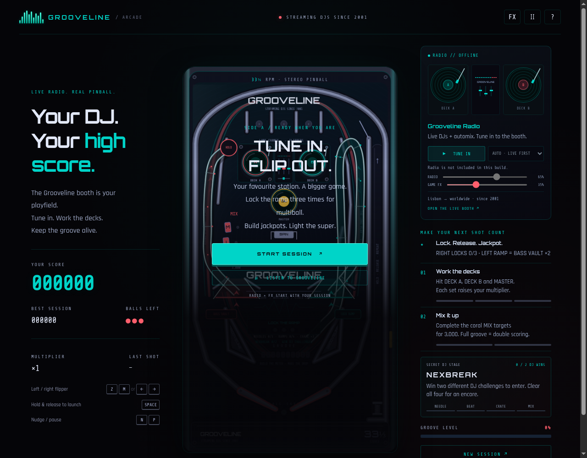

# Grooveline Pinball

A DJ-themed pinball game for the browser: one canvas, plain JavaScript, no build
step, no dependencies. Built for [Grooveline](https://grooveline.org), an internet
radio station.



## Play

```bash
python3 -m http.server 8000   # then open http://localhost:8000/
```

Flippers: `Z` / `M` or the arrow keys. Hold and release `Space` to launch. `N` nudges,
`P` pauses. On phones: touch controls, drag to launch.

## What's in it

- **Turntable table:** the bumpers are records, and the
  middle of the table is a DJ booth with two decks and a mixer that react to play.
- **Four DJ challenges** unlock as you play: Needle Drop (steer a tonearm onto a cue),
  Beat Match, Crate Dig (a memory sequence) and Headliner Mix (hold a crossfader zone).
- **Multiball, jackpots, a score multiplier and a combo system.**
- **Secret stage:** win two different DJ challenges to unlock NexBreak, a full
  breakout game embedded in an iframe (`assets/nexbreak-*`).
- **Synthesized sound effects** (Web Audio, no samples), mobile touch handling with
  stuck-flipper recovery, and an optional shake-to-nudge.

## Layout

| File | Role |
| --- | --- |
| `index.html` | Page, styles and the embedded fonts |
| `assets/game-v54.js` | Physics, rules, rendering |
| `assets/sessions-v51.js` | The DJ challenge engines |
| `assets/sound-v51.js` | Synthesized effects |
| `assets/live-table.js` | Booth artwork driven by the audio state |
| `assets/mobile-v49.js`, `ui-v52.css` | Touch handling and layout |
| `assets/nexbreak-*` | The embedded NexBreak bonus stage |
| `assets/scoreboard-v54.js` | Local best score, optional online scoreboard |
| `assets/radio.js` | Radio stub (see below) |

## About this open-source build

- **Radio is disabled.** The live game tunes into the Grooveline radio stream. In this
  repo `assets/radio.js` is a stub that makes no network requests, so the game has
  sound effects but no music.
- **Online scoreboard is disabled.** Set `window.PINBALL_SCORE_API` to a compatible
  endpoint (`GET ?limit=N`, `POST {name, score, shots, maxCombo, duration, version}`)
  to turn it on. Otherwise only your best session is kept locally.
- The version numbers in the file names are the original release numbers.

## License

Code: MIT, see [LICENSE](LICENSE). The embedded fonts (Orbitron, Rajdhani, Share Tech
Mono) are under the SIL Open Font License, see `assets/*-OFL.txt`.
